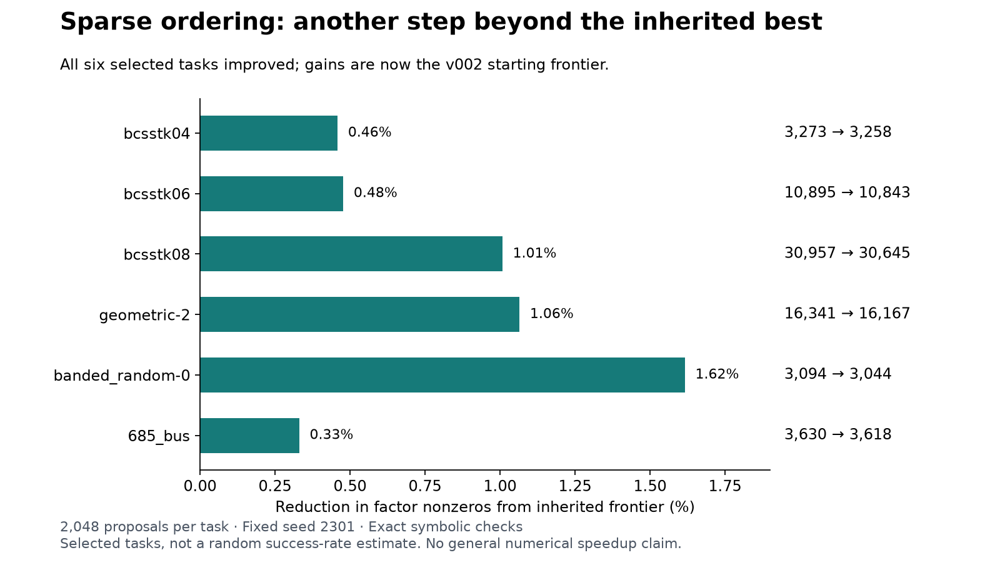

# Sparse matrix ordering

[](https://github.com/discoveryathome/sparse-matrix/actions/workflows/checks.yml)

**Contributions and expert review are open.** Find elimination orders that reduce fill-in when factoring a sparse matrix. A contribution is a permutation plus a compact, independently checkable symbolic score.

The active project frontier contains 28 distinct inputs: 12 historical matrices across structural engineering and power networks, plus 16 explicitly synthetic examples. Every task starts from the best verified order we have inherited. The current frontier is v002; older versions remain reproducible.

## Start a contribution

```sh
sh tools/setup.sh
.venv/bin/python tools/check.py
.venv/bin/python tools/verify_active.py
.venv/bin/python tools/contribute.py --matrix <drawn matrix> --seed <your seed> --attempts 2048 --out research/my-trial
.venv/bin/python tools/verify_submission.py research/my-trial/candidate.json
```

Draw the matrix (`discover pick --live --seed <your seed>`, or any matrix in discover/frontier-table.json) and use your own seed: rerunning someone else's seed on the same matrix repeats their search. Use a fresh output directory. A null result is valid evidence but is not a frontier improvement. To reproduce an older task, pass --frontier-version v001.

Requires Python 3.12, uv, a C compiler and SuiteSparse. On macOS use `brew install suite-sparse`; on Ubuntu use `sudo apt-get install build-essential libsuitesparse-dev`. Fresh macOS setup and Ubuntu CI pass; see [current release status](docs/STATUS.md).

Read [contributor instructions](docs/CONTRIBUTING.md), [the feature brief](docs/FEATURE_BRIEF.md), and [the current assessment](research/distribution-prep/ASSESSMENT.md). Original protocols and evidence remain under research/ and results/.

## Evidence and limits

The broader round improved symbolic factor storage on 20/24 patterns, including 8/9 held-out cases. New power-network qualification improved 3/4 inputs. A subsequent donor rehearsal improved all six selected tasks beyond the best inherited orders; those improvements are now the default frontier.

These are project-instance gains, not established literature records or a general solver speedup. Numerical timings remain mixed. The symbolic leaderboard and performance evidence are deliberately separate: leaderboards/symbolic.json and leaderboards/performance.json.

Public repository: https://github.com/discoveryathome/sparse-matrix. The MIT license covers our code; external benchmark attribution and redistribution review are documented in THIRD-PARTY.md and docs/RELEASE_CHECKLIST.md.



Setup downloads historical inputs directly from their source hosts, checks SHA-256 hashes, and reconstructs derived inputs. These inputs are ignored by Git and retain their upstream terms. Our code, synthetic inputs, result certificates and trial traces are included. See [public packaging notes](docs/PUBLICATION.md).
